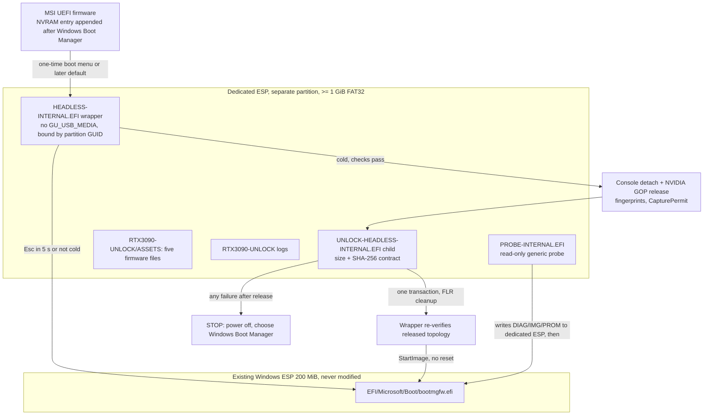
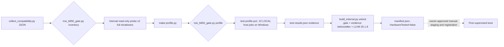

# MSI B850 / RTX 3060 internal-SSD boot: audit, plan and determination

Branch: `experimental/msi-b850-rtx3060-internal-boot` · Date: 2026-11-22 · Status: **software only, hardware untested**

## 0. Short answer

**Internal-SSD boot without a USB stick is feasible in software on this repository, and nothing found in the source rules it out for this machine. Whether it works on this exact MSI B850 / RTX 3060 cannot be decided yet**, because every hardware fact the unlock depends on (PROM, NVIDIA GOP driver code, console topology, PCI path, BAR0, cold-state selectors, iGPU GOP behaviour) is still unknown. They can only come from read-only probe captures of this machine.

Why the software side is feasible (verified in source, Section 2):

* The unlock child and the headless wrapper differ between "USB" and "internal" **only in how they find their own volume**: `GU_USB_MEDIA` selects "the USB device I was loaded from", while its absence selects "the partition with GUID X" (`internal-boot/boot/handoff.c` `Prepare`, `internal-boot/unlock/app_io.c` `UsbPath`). The release, checks, transaction and Windows handoff code is the same.
* The repository's own LOCAL host-test suite (`research/profile/test-profile.ps1`) **already runs the internal headless child** (`headless internal` job) for every generated LOCAL profile.
* What blocks LOCAL profiles from internal boot is **build and installer wiring**, not C code: `Get-LocalProfile` hardcodes `UsbOnly=$true`, and `Configure.ps1`, `build-unlock.ps1`, `Headless.ps1` and `headless-package.ps1` accept only the three ASUS profile names and SMBIOS strings.
* The repository's generic read-only probe compiles without `GU_USB_PROBE`, so even **data collection can run from an internal partition**.

What this branch adds is a separate, gated build path for those internal images (Section 6). It does not change any existing file or profile.

What blocks a hardware answer: the evidence list in Section 8. The highest-risk unknowns are listed in Section 4.7.

## 1. Method and labels

Every claim below is tagged:

| Tag | Meaning |
|---|---|
| **[V]** | Verified in this repository's source or by a test that was actually run here |
| **[R]** | Reported by you from Windows (not independently verified) |
| **[A]** | Assumption built into the source code |
| **[U]** | Unknown until this machine is probed |
| **[H]** | Hypothesis that needs a physical test |

Environment used: Linux cloud container, clang/lld 18.1.3 (the repository pins 20.1.8), PowerShell 7.4.6, Python 3.13. No MSVC, no Windows, no hardware. No firmware, GPU, disk, ESP, BCD or boot-order operation was run.

## 2. Repository audit

Source revision: `88961cc` (upstream head when cloned).

### 2.1 How the USB boot route works [V]

There are two USB routes.

1. **Legacy USB manual** (`unlock/`, `release/EFI/BOOT/BOOTX64.EFI`): the original v0.1.0 release for the ASUS B650M / RTX 3090 FE. It requires the AMD iGPU display (`unlock/port.h` `GU_AMD_ID 0x164e1002`, `unlock/app.c` `AmdGopParent`), a U key press, then a firmware Boot Override to Windows. It does not apply to your machine (different iGPU, monitor on the RTX).
2. **Headless USB** (`research/headless/build-usb.ps1`, `stage-usb.ps1`): wrapper `HEADLESS.EFI` plus child `UNLOCK-HEADLESS.EFI`, compiled with `-DGU_USB_MEDIA`. Flow (`internal-boot/boot/full-flow.c`, `handoff.c`):
   1. `Prepare`: the wrapper's own device must have a USB node; it finds the Windows ESP by GUID, opens a log, loads the child into memory, checks its exact size and SHA-256 against the compiled-in contract, and pre-loads `\EFI\Microsoft\Boot\bootmgfw.efi`.
   2. `FullChoice`: 5-second Esc window (Esc means Windows without changes), then `GuPeekCold`: if the GPU is not in its power-on state, it skips release and starts Windows.
   3. `FullCapture` → `FullRelease`: console detach and NVIDIA GOP driver release (`full-release.c`), with exact driver fingerprints and `CapturePermit`.
   4. `FullVerifyCold`, then `StartImage(child)`: the child repeats its own identity/BAR/PROM/cold/display checks and runs the single guarded transaction (`internal-boot/unlock/app.c`, `vendor/unlock_610.c`), ending in FLR cleanup.
   5. `FullWindows`: verify released topology, close files, verify again, `StartImage(Windows Boot Manager)` with no reset.
   6. If nothing was released yet and it fails, the USB build returns to the firmware boot order. After a release, any failure stops ("power off") with no retry.

### 2.2 How the internal-ESP route works [V]

Same wrapper/child sources compiled **without** `GU_USB_MEDIA` (`research/headless/build-unlock.ps1` → `internal-boot/unlock/build.ps1 -InternalBoot -AutomaticBoot -HeadlessResearch`).

* `internal-boot/Configure.ps1` (read-only) checks a **separate** FAT32 GPT-ESP-type partition of at least 1 GiB with a drive letter, that is not the system ESP, plus the Windows ESP containing `bootmgfw.efi`; it writes `boot/platform-config.h` with both partition GUIDs.
* At boot, `Prepare` requires that the partition with the configured GUID is exactly one handle and is the device the wrapper was loaded from; the child's `UsbPath` accepts only that partition (`GuPathIsPartition`).
* `internal-boot/Headless.ps1` stages files to `\EFI\WindowsGPUUnlock\` on that ESP, then (separate switches) registers a firmware entry with `bcdedit /copy {bootmgr}` appended **after** Windows, and later can promote it to first with Fast Startup off. `-RestoreWindowsFirst` puts Windows Boot Manager first again without needing any EFI file.

### 2.3 Shared components [V]

* All transaction code: `internal-boot/unlock/{app,app_io,ownership,checks,port,runtime,sha256,format,compat}.c`, `vendor/*_610.c`.
* Wrapper: `internal-boot/boot/{handoff,full-release,full-flow,diagnostic}.c`.
* GPU family traits `gpu-family.h` (GA102/GA104/GA106), firmware assets `assets.json` (the same five files for every GA10x profile, including GA106).
* Media binding is the only USB/internal difference (Section 0).

### 2.4 Components specific to the ASUS B650M + RTX 3090 FE profile [V]

* `machine-profile.h` default branch (`GU_PROFILE_B650M_3090FE`): 10de:2204 / 10de:1454, BAR0 `0xf5000000`, 0x6000 MiB, PROM hash, root port 1.1, display path bytes.
* `firmware-profile.h` `GU_FIRMWARE_AMI_B650M_3057`: AMI console/EDID driver sizes and hashes, nvgop 0x60008.
* `internal-boot/unlock/port.h` `GU_AMD_ID 0x164e1002` / `GU_AMD_SUBSYSTEM 0x88771043` and `app.c` AMD GOP checks (manual AMD-display variant only).
* `headless-package.ps1` `Get-HeadlessProfileIdentity`: `TUF GAMING B650M-PLUS WIFI` / BIOS `3057` (and the B660M strings).
* Documentation of the F8 boot menu (ASUS key; MSI uses a different key [U]).
* `research/headless/register-observe.ps1` hardcodes one ASUS child hash.

### 2.5 What prevents LOCAL profiles from using internal boot [V]

| Location | Block |
|---|---|
| `internal-boot/unlock/local-profile.ps1` `Get-LocalProfile` | returns `UsbOnly=$true`; `build.ps1` then refuses `-ExperimentalUnlock` without `-UsbMedia` |
| `internal-boot/Configure.ps1` | `ValidateSet` of three ASUS profiles; SMBIOS board/BIOS must match them |
| `research/headless/build-unlock.ps1` | `ValidateSet` of three ASUS profiles; no LOCAL evidence handling |
| `internal-boot/install/headless-package.ps1` | `Assert-HeadlessPackage` accepts only the three ASUS profile names |
| `internal-boot/Headless.ps1` | `Target` re-checks SMBIOS board/BIOS against the ASUS identity |
| `docs/NEW-MACHINE.en.md` | states the internal-ESP and manual paths refuse LOCAL |

No C-level `#error` forbids `GU_PROFILE_LOCAL` with internal media. `GU_NO_EDID_DRIVER` is restricted to the headless build, which is what this plan uses.

### 2.6 Hardcoded hardware assumptions [V]/[A]

* Target at device 0 function 0 on a nonzero bus; reviewed profiles bus 1, segment 0 (`machine-profile.h`). LOCAL may pin another bus/segment.
* BAR0 is a 32-bit, 16 MiB-aligned 16 MiB resource; PROM read through a 1 MiB window.
* Exact `(PCI ID, chip, VRAM)` tuples (`gpu-family.h`): GA106 only `250410de` + `0x3000` MiB + chip `b76000a1`.
* nvgop (VBIOS GOP) `.text` hash must be one that already released cleanly on hardware (`proven.json`); GA106 admits only 0x60010 / `615b37a7…`.
* AMI console text/graphics splitter drivers; aggregate or direct console graph; at most one non-NVIDIA display controller and **no second physical GOP**.
* PciIo attribute cache must equal the PCI command IO/MEM bits (`full-release.c` `CapturePermit`, enforced earlier by `make-profile.py`).
* Firmware asset file names are GA102-named but used for all GA10x.
* On-disk names: `\EFI\WindowsGPUUnlock\`, log folder `\RTX3090-UNLOCK\`, Windows at `\EFI\Microsoft\Boot\bootmgfw.efi`.
* Dedicated ESP ≥ 1 GiB (installer policy).

### 2.7 Checks before GPU ownership changes [V]

Wrapper, before any release: own-volume and Windows-ESP identity (exactly one match each), child size and SHA-256, Esc window, `GuPeekCold` cold-state pre-check (skip to Windows if not cold).
Release (`full-release.c`): exact console/EDID/nvgop image size, Stop offset and `.text` SHA-256, exact ownership graph and child paths, `CapturePermit` (attribute cache vs command), no unexpected owners, re-verification after each stage.
Child (`app.c`): `ConfigCheck` (exact ID/subsystem/class, MEM on, BME off, ROM off, capability list fully parsed, D0), `BarCheck`, `PromCheck` (SHA-256), `ColdCheck`, headless display policy (no physical GOP), owner identity unchanged between check and release, repeated after release and immediately before arming; one attempt only; FLR, DMA and mapping cleanup; `STOP / POWER OFF` on unsafe return.

### 2.8 Tests and fixtures [V]

* Python/C host tests under `research/profile`, `research/pci-decode`, `research/headless`, `research/amd-retained`, `internal-boot/unlock/tests`, `tools`, `benchmark`.
* Windows-only PowerShell suites needing MSVC (`internal-boot/unlock/test-all.ps1`, `internal-boot/boot/test*.ps1`, `research/profile/test-profile.ps1`) and private fixtures (real PROM, captures, the five firmware assets).
* Synthetic LOCAL generators: `test_local_release.py`, `test_aggregate_local.py`, `test_aggregate_efi.py` (include GA106 `250410de` cases).

## 3. Your machine compared with the existing profiles

| Property | ASUS B650M / 3090 FE (original) | Closest existing evidence | Your machine |
|---|---|---|---|
| Board / BIOS | ASUS TUF B650M-PLUS WIFI / 3057 | MSI MAG B650 TOMAHAWK (AM5, LOCAL USB, issue #136); Gigabyte X870 (AM5, Granite Ridge) | MSI B850 GAMING PLUS WIFI6E MS-7E80 / 1.A20 [R] |
| CPU / iGPU | Raphael 1002:164e | X870: Granite Ridge 1002:13c0, "present, no GOP" | Ryzen 7 9700X, 1002:13c0 / 1462:ee80 [R] |
| GPU | GA102 10de:2204 / 10de:1454, 24 GiB | H610M: GA106 10de:2504 / 1458:4096, one success (USB) | GA106 10de:2504 / 1462:397d, 12 GiB [R] |
| Firmware console | AMI direct, EDID driver present | Several MSI boards: **no EDID driver**; some MSI boards: attribute-cache mismatch (#102) | [U] |
| nvgop | 0x60008 | H610M GA106: 0x60010 | [U] |
| Boot route | internal headless (ASUS F8) | all GA106 results are USB | internal wanted |

The ASUS profile is not a substitute and is not modified. `msi_b850_gate.py` explicitly refuses the ASUS, H610M and B660-PLUS identities (tested).

## 4. Feasibility by component

### 4.1 MSI B850 UEFI firmware
* AMI BIOS [R] matches the envelope's "AMI console" requirement [A]; actual driver fingerprints in 1.A20 [U].
* MSI boards in the record often bind **no EDID driver**; LOCAL supports that only on the non-aggregate headless path, which is the path used here [V].
* MSI X570 boards showed a PciIo attribute cache of `0x300` with command `0x0002`. On main this is **refused** by `make-profile.py` and `CapturePermit`; the "decode pre-step" that fixed it is not in main [V]. If your board does the same, the current code will refuse, and that must be reported, not bypassed.
* Whether MSI firmware keeps and boots an NVRAM entry pointing at a second ESP [H]. MSI's one-time boot menu key (usually F11) [U].

### 4.2 Ryzen 7 9700X
No CPU-specific code exists; the CPU matters only through the PCIe root-port path and the iGPU. Root port and full ancestry are captured, never assumed [V]. AM5 profiles in the record used root port 1.1 [V]; yours [U].

### 4.3 RTX 3060 GA106 12 GB
* GA106 `250410de` / 0x3000 MiB / `b76000a1` is a reviewed family tuple, uses the same transaction (`unlock_610.c`) and the same five assets; one physical success exists (H610M, USB) [V].
* **The existing release implementation can be used as-is**; no different implementation is needed, provided your card's PROM parses (FWSEC-FRTS within tested bounds) and its nvgop is exactly 0x60010 `615b37a7…` [V for code, U for your card].
* MSI subsystem 1462:397d and its VBIOS are different from the tested Gigabyte card [R]; any other nvgop build is refused by the envelope [V].

### 4.4 AMD integrated graphics
Allowed: at most one non-NVIDIA display controller, but the RTX must own the only **physical GOP** [V]. On your board the iGPU is enabled in Windows [R]; whether BIOS 1.A20 gives it a GOP depends on settings such as integrated-graphics mode and whether a monitor is attached to motherboard outputs [U]. Keep the monitor on the RTX only during probing and testing.

### 4.5 Internal EFI boot
Feasible in code (Section 0). Requires a **separate** ESP; see Section 5.

### 4.6 Windows Boot Manager handoff
Same code for USB and internal: `LoadImage` of `bootmgfw.efi` from the Windows ESP found by GUID, `StartImage` with no reset [V]. Windows build 26300 (Insider-numbered) and your NVIDIA driver version have no recorded result [U]. BitLocker must be fully off on C: [V check, R state unknown].

### 4.7 Highest-risk unknowns
1. nvgop version/hash on the MSI 1462:397d VBIOS.
2. PciIo attribute cache mismatch (MSI pattern).
3. iGPU GOP present in firmware.
4. MSI firmware handling of the extra NVRAM boot entry.
5. Cold-state behaviour after a Windows restart on this board (X870 resets the GPU on restart; H610M needed full shutdown) [U].

## 5. The 200 MiB Windows ESP

* Never used, formatted or written by anything on this branch [V: `test_python_tools_have_no_install_paths`, `test_inspector_has_no_mutating_commands`].
* The repository's design forbids staging into the Windows ESP, and `gsp_ga10x.bin` alone is 84 MB [V], so even capacity is marginal.
* **A separate dedicated ESP is required** (≥ 1 GiB, FAT32, GPT type `c12a7328-…`). Options you can choose from, none performed by any tool:
  1. Shrink C: in Windows Disk Management and create the new volume (requires a full backup, BitLocker off; risk is yours to accept).
  2. A partition on a second internal drive, if you have one.
* `research/msi-b850-rtx3060/inspect-esp.ps1` reports the layout and validates a candidate **read-only**.

## 6. Design implemented on this branch

### 6.1 Architecture

### 6.2 Files added (nothing existing changed)

| File | Purpose |
|---|---|
| `research/msi-b850-rtx3060/target.json` | Your reported identity; explicit list of unknowns. Grants nothing. |
| `research/msi-b850-rtx3060/msi_b850_gate.py` | Offline checks: collector JSON vs target; generated LOCAL profile vs target and `proven.json`; readiness report. `can_unlock` is always false. |
| `research/msi-b850-rtx3060/build_internal.py` | Builds (never installs) the internal read-only probe, or the internal LOCAL wrapper/child. Same sources and flags as `build.ps1` / `build-unlock.ps1` / `build-probe.ps1`, minus only `GU_USB_MEDIA` / `GU_USB_PROBE`. Partition header via a clang VFS overlay, so nothing under `internal-boot/` is written. |
| `research/msi-b850-rtx3060/inspect-esp.ps1` | Read-only Windows inspection of partitions, ESPs, Secure Boot, BitLocker, SMBIOS. |
| `research/msi-b850-rtx3060/test_msi_b850.py` | 22 host tests (Section 7). |
| `research/msi-b850-rtx3060/tests/fixtures/synthetic-ga106-direct-noedid.h` | Synthetic compile fixture, labelled as such. |

Placement under `research/` is deliberate: the LOCAL evidence digest (`Get-LocalTreeDigest`) and the ASUS package inventory (`Get-HeadlessInputInventory`) do not cover this folder, so adding it does not invalidate anyone's existing evidence or packages.

### 6.3 Gates a real `unlock` build must pass (all fail closed)

1. Two distinct, non-zero partition GUIDs.
2. clang and lld-link report LLVM 20.1.8.
3. `profile-local.h` exists, was generated by `make-profile.py`, and passes `msi_b850_gate.py profile`: 10de:2504, subsystem 1462:397d, chip `b76000a1`, 0x3000 MiB, segment 0, nvgop in `proven.json` GA106 list, PROM/BAR/path pins present, `profile.json` bound to the exact header bytes, ≥ 2 captures, iGPU absent or 1002:13c0.
4. `Assert-LocalProfileEvidence` (the repository's own gate) passes **before and after** compiling, unchanged.
5. Output directory must not exist; nothing is overwritten.

The existing USB refusal for LOCAL in `build.ps1` is untouched; the new path is a separate script with stronger identity requirements, not a relaxed flag.

### 6.4 Deliberately not implemented
Staging to an ESP, BCD/NVRAM registration, promotion to default, Fast Startup changes. These change boot configuration and need your explicit approval each time; they are written as a manual procedure in Section 9. The existing `Headless.ps1` refuses these packages by name, which is intended.

## 7. Tests and build results (actually run)

| Run | Result |
|---|---|
| New suite `test_msi_b850.py` (clang 18.1.3, Linux) | **22/22 pass**: inventory gate (match + 9 refusals), profile gate (match + 3 reviewed-profile substitutions refused + 13 malformed/out-of-envelope refusals + 6 report-binding refusals), CLI exit codes, builder policy (flag parity with repository scripts, GUID rules, unpinned toolchain refused, missing LOCAL profile refused, no overwrite), static read-only checks, synthetic internal **child + wrapper + probe compiled, linked and PE-verified**, preprocessor check that the internal partition branch (not the USB branch) is compiled, and the repository's `test_handoff.c` run with a two-ESP configuration (failures=0) |
| Existing Python/C host tests, before and after | identical: 42 of 47 scripts pass with the generic runner; of the other 5, `test_stock_selection.py` (19 selector cases + 14 rejections), `test_pe.py` and `test_aggregate_efi.py` (12 synthetic LOCAL cases incl. GA106) pass with their required arguments; `test_b660m_3090ti_profile.py` 2/3, the third fails only on PowerShell 7 vs 5.1 error text (the refusal itself happened); `test_make_profile.py` needs real captures (not run) |
| Synthetic GA106 LOCAL release replay (`test_local_release.py`) | 28 GA106 cases pass (direct console, EDID present/absent, 1–4 children, bus 1 and 0x2b) |
| `internal-boot/unlock/build.ps1` regression (pwsh, temporary synthetic partition header, removed afterwards) | preflight and ASUS headless child build and PE-verify; `local` refused (no profile); `h610m-3060` internal refused (USB only) |
| clang static analyzer on all internal LOCAL wrapper/child sources | clean except one finding in shared `vendor/unlock_610.c:285` (`check_entry_selectors`): analyzer cannot see that `GU_RESULT(-EIO)` is non-zero; reviewed as a false positive, code not changed |
| pyflakes on new Python | clean |
| PowerShell parser on `inspect-esp.ps1` | 0 errors; **never executed on Windows** |

Not run (need Windows + MSVC + your private data): `test-all.ps1`, `internal-boot/boot/test*.ps1`, `test-profile.ps1` (22 LOCAL jobs), any test using a real PROM or the five firmware assets. Host Linux runs used a small out-of-tree shim (UEFI-size `wchar_t`, `_aligned_malloc`→`aligned_alloc`); production builds do not use it.

**None of this is hardware evidence.** The EFI files built here used clang 18 and synthetic inputs; their hashes mean nothing for your machine.

## 8. Remaining hardware validation requirements (exact missing evidence)

1. Collector JSON from `python -I .\tools\collect_compatibility.py > inventory.json` passing `msi_b850_gate.py inventory` (pins exact SMBIOS strings).
2. `inspect-esp.ps1` output showing a separate ≥ 1 GiB FAT32 ESP, Secure Boot off, C: fully decrypted and protection off.
3. **Two read-only probe captures from separate full shutdowns** (`DIAGnn.TXT`, `IMGnn.BIN`, `PROM.BIN`), monitor on the RTX only, CSM off. They provide: segment/bus/root path, BAR0, PROM hash and FWSEC location, nvgop version/hash, console drivers, EDID driver presence, child count, iGPU GOP presence, attribute cache, cold selectors.
4. `make-profile.py` accepting them (otherwise: the refusal text is the result to report).
5. `test-profile.ps1` passing all 22 jobs on Windows with your PROM and the five assets (writes `test-results.json`).
6. `build_internal.py unlock` with LLVM 20.1.8 succeeding.
7. A first supervised boot via one-time boot menu: wrapper log `HLS*.TXT`, child `AUTO*/REPORT.TXT` with `FINAL status=0 clean=1`, `SS0=0x88888888 SS1=0x8`, Windows and display return, before/after benchmark on the same driver.
8. Repeat cold boots before any promotion to default; separate test of Windows restart behaviour.

## 9. Future procedure (owner-run; each step needs your go-ahead)

1. Read-only: collector + gate; `inspect-esp.ps1`.
2. Your decision: create the separate ESP (Section 5). Not automated.
3. Build probe: `python research\msi-b850-rtx3060\build_internal.py probe --internal-esp-guid <new ESP> --windows-esp-guid <Windows ESP> --clang <LLVM20>\clang.exe --lld-link <LLVM20>\lld-link.exe`.
4. Manual staging (your approval): copy `PROBE-INTERNAL.EFI` to `U:\EFI\WindowsGPUUnlock\`, create `U:\RTX3090-UNLOCK\`. Register a test entry **after** Windows (back up BCD with `bcdedit /export` first; mirror `Headless.ps1 -Register`: `bcdedit /copy {bootmgr} /d "GPU Probe - READ ONLY"`, set `device partition=U:` and `path \EFI\WindowsGPUUnlock\PROBE-INTERNAL.EFI`, append to `{fwbootmgr} displayorder`). Boot it twice from full shutdown via the one-time menu.
5. Copy captures to `research\profile\local\capture\`, run `make-profile.py`, `msi_b850_gate.py profile`, `test-profile.ps1`.
6. `build_internal.py unlock …`, stage the wrapper/child/assets, point the test entry at the wrapper, one supervised boot.
7. Only after repeated success: consider making it default (Windows Boot Manager remains in the order).

## 10. Recovery and rollback strategy

Principles: Windows ESP, Windows Boot Manager and C: are never written by these tools; every new item lives on a separate partition and in an **appended** boot entry; Windows stays first until you explicitly decide otherwise.

| Situation | Recovery |
|---|---|
| Before any boot change | Nothing to roll back. `bcdedit /export` backup is taken before step 4. |
| Probe or wrapper stops before release ("Nothing was changed" / stop screen) | Power off fully, start, choose **Windows Boot Manager** in the one-time menu. GPU untouched. |
| Stop after driver release or transaction | Do not reset or retry. Full power-off (PSU off a few seconds to clear GPU state), then Windows Boot Manager. |
| Test entry misbehaves | In Windows: `bcdedit /delete {id}` (or `bcdedit /import` of the backup); if Windows does not start: firmware setup → put Windows Boot Manager first. |
| After promotion to default | `internal-boot\Headless.ps1 -RestoreWindowsFirst`-equivalent: `bcdedit /set {fwbootmgr} displayorder {bootmgr} /addfirst`; restore Fast Startup value you saved. |
| Firmware drops or reorders entries [H] | Windows Boot Manager is untouched and remains selectable; re-run the registration only after reviewing why. |
| Full removal | Delete the entry, delete the dedicated ESP files or the partition yourself; Windows ESP and C: are unaffected. |
| Worst case Windows will not boot | Windows Recovery (the existing ~930 MiB partition) or install media → `bcdboot` repair of the **Windows** ESP; the dedicated ESP is irrelevant to Windows boot. |

Keep: BCD export, `inspect-esp.ps1` JSON, collector JSON, every log, and a full disk image before step 2.

## 11. Determination

* **Software: feasible.** Internal-ESP headless boot for a LOCAL GA106 profile needs no new GPU implementation; the shared code already supports it, the LOCAL host tests already cover the internal child, and this branch adds a gated, tested build path.
* **This exact hardware: undetermined.** No hardware evidence exists yet; the decisive data come from two read-only probe boots. Known ways it could fail closed: unreviewed nvgop build, MSI attribute-cache mismatch, iGPU GOP, firmware boot-entry handling. Each would be reported as a refusal; none may be bypassed.
* **No USB at any step** is possible with this branch's internal probe, at the cost of creating a separate ESP and an appended firmware entry, both your decisions.
